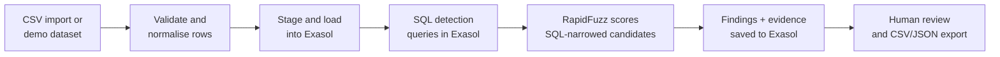

# LeakageLens

**Find the money your business is silently losing.**

Evidence-led supplier payment audits, powered by Exasol SQL.

- **Event:** ExaThon India 2026
- **Problem track:** Money, Risk & Regulation
- Demo video:(https://drive.google.com/drive/folders/1cbyi_4ZnNeNfogrKTpBU8kfvaHGfUxDA?usp=drive_link)
- ppt:(https://drive.google.com/file/d/14lRmWJ-rB-DC4YlbiYnBmfg3fujaXbcv/view?usp=sharing)

---

## 1. Problem statement

Companies pay thousands of supplier invoices every month, and small errors slip through: the same invoice is paid twice, a supplier bills more than the approved purchase order, or a credit note is never deducted. Each mistake is small, but across thousands of records they add up to real money, and they are hard to spot because the evidence is spread over four separate record types (invoices, purchase orders, payments and credit notes).

Finance and audit teams usually check this by hand or in spreadsheets, which does not scale and rarely leaves a clear audit trail. They need a way to compare all four record types automatically, and to get a short list of cases that each come with evidence a person can verify.

**LeakageLens** reconciles invoices, purchase orders, payments and credit notes, flags the discrepancies, explains each one with its source records and calculation, and keeps the final decision with a human reviewer.

> Findings are investigation candidates, not proof of fraud or confirmed savings.

## 2. What it detects

| Check | What it means | Counted as exposure |
|---|---|---|
| Duplicate invoice | Same supplier, same invoice number (punctuation ignored) | Yes |
| Possible duplicate invoice | Very similar reference, amount and date (fuzzy match) | No, review only |
| Overpayment | Paid more than invoice minus unapplied credits | Yes |
| Possible duplicate payment | Two equal settled payments on one invoice within 30 days | Yes |
| Unapplied credit note | Supplier credit exists but the invoice was paid in full | Yes |
| Purchase order mismatch | Invoice higher than the approved PO beyond a tolerance % | Yes |
| Unmatched payment | Completed payment with no known invoice | No, review only |
| Data quality | Invalid dates or missing identifiers | No, review only |

Gross flagged amounts can overlap, so the app also reports **estimated unique exposure**: findings linked to the same invoice are counted once, and currencies are never mixed.

## 3. How it works



1. **Load:** import CSVs with field mapping, or load the built-in synthetic dataset. Bad rows are rejected with a reason.
2. **Detect:** SQL detection queries (in [`database/detections/`](database/detections/)) run inside Exasol. A SQL query narrows look-alike invoice references, and RapidFuzz scores only those candidates.
3. **Explain:** every finding shows expected vs observed amounts, source record IDs, a confidence score and a next action.
4. **Review:** mark findings New, Under Review, Confirmed, False Positive or Resolved, then export a findings CSV and a JSON evidence pack.

## 4. How Exasol Personal is used

- **Schema and tables:** [`database/schema.sql`](database/schema.sql) creates the source tables (`SUPPLIERS`, `PURCHASE_ORDERS`, `INVOICES`, `PAYMENTS`, `CREDIT_NOTES`) and the audit tables (`AUDIT_RUNS`, `FINDINGS`, `FINDING_EVIDENCE`).
- **Safe loading:** source data is bulk-loaded into staging tables first, then the current snapshot is replaced in one transaction. If staging fails, the existing tables are left untouched.
- **In-database detection:** duplicate invoices, duplicate payments, overbilling, missed credits, payment mismatches, unmatched payments and fuzzy candidates are SQL queries that run in Exasol.
- **Audit trail:** run details, findings, SQL evidence and per-query timings are written back to Exasol.
- **Local mode:** without database credentials the app runs the same checks in Python on the session data, so it can be tried without a database.

### Verification status

The Exasol code path (connection, schema, staged load, SQL detections, persistence) is implemented and covered by unit tests with a mocked connection. **It has not yet been run against a live Exasol Personal instance**, so SQL syntax and import behaviour should be smoke-tested on your instance (see [Setup](#5-setup-and-reproduction)). The local Python path has been run end to end on the demo data.

## 5. Setup and reproduction

**Requirements:** Python 3.11 or later. Node.js is not needed (`frontend/` is an unused Vite starter).

```bash
git clone https://github.com/<your-username>/<your-repo>.git
cd <your-repo>
python3 -m venv .venv
source .venv/bin/activate            # Windows PowerShell: .\.venv\Scripts\Activate.ps1
pip install -r requirements.txt
streamlit run app.py
```

Open <http://localhost:8501>.

### Run in local mode (no database)

1. Open **Start Here** for a guided walkthrough, or go to **Overview Dashboard**.
2. Click **Load demo dataset** (10,009 synthetic records).
3. Open **Financial Audit** and click **Run analysis**.
4. Open **Findings Explorer** to inspect evidence, then **Reports** to download CSV/JSON.

**Expected result on the demo dataset:** estimated unique exposure of **INR 7,107,157.40**.

### Run on Exasol Personal

1. Copy the example settings and fill in your own instance details:
   ```bash
   cp .env.example .env
   ```
   Set `EXASOL_DSN` (host:port), `EXASOL_USER` and `EXASOL_PASSWORD`. `EXASOL_SCHEMA` defaults to `LEAKAGELENS`. Keep `.env` private; it is git-ignored.
2. Open **Settings**, click **Test Exasol connection**, then **Initialize or upgrade Exasol schema**.
3. In **Data Import**, load the demo dataset (or your CSVs) and confirm **Initialize schema and load snapshot to Exasol**.
4. Open **Financial Audit** and run the analysis in Exasol mode. The audit ID and query timings are shown on completion.

### Command line (no UI)

```bash
python backend/leakagelens_cli.py --load data/demo_csv     # create schema, load, analyse
python backend/leakagelens_cli.py --tolerance 5            # later runs, 5% PO tolerance
```

To use a SQL client instead, run `database/schema.sql`, then `backend/sql/02_load_demo_data.sql` from the project root, then the statements in `backend/sql/03_detections.sql`. See [backend/README.md](backend/README.md).

### Run the tests

```bash
python -m pytest -q
```

## 6. Project layout

```
app.py, pages/, src/      Streamlit UI and the analysis + Exasol integration (src/core.py, src/exasol.py)
database/                 Schema and the detection SQL that runs inside Exasol
backend/                  Headless CLI runner and SQL-client scripts (reuse src/)
data/demo_csv/            Full demo dataset (10,009 records)
data/sample_csv/          Small CSV templates for the importer
docs/                     How it works, architecture, demo script, troubleshooting, pitch deck
tests/                    Unit and regression tests
```

More detail: [docs/how-it-works.md](docs/how-it-works.md), [docs/architecture.md](docs/architecture.md), [docs/demo-script.md](docs/demo-script.md), [docs/troubleshooting.md](docs/troubleshooting.md).

## 7. Data sources and licence information

- **Data:** all data is **synthetic and fictional**, generated by the app with a fixed seed (`2026`), so results are reproducible. It contains 60 suppliers, 3,000 purchase orders, 3,030 invoices, 3,119 payments and 800 credit notes (10,009 records), all in INR. The same data is saved in [`data/demo_csv/`](data/demo_csv/). No real supplier, customer or financial data is included.
- **Your own data:** uploaded CSVs are validated locally and sent to Exasol only after you confirm the load. Use synthetic or approved data only.
- **Code licence:** Apache License 2.0. See [LICENSE](LICENSE).

## 8. APIs and third-party tools

LeakageLens calls **no external web APIs**. The only network connection is to your configured Exasol instance.

| Tool | Used for | Licence |
|---|---|---|
| [Exasol Personal](https://www.exasol.com/) | Database that runs the detection SQL | Exasol's own terms |
| [PyExasol](https://github.com/exasol/pyexasol) | Python driver and CSV bulk import | MIT |
| [Streamlit](https://streamlit.io/) | Web interface | Apache 2.0 |
| [pandas](https://pandas.pydata.org/) | Data handling | BSD 3-Clause |
| [RapidFuzz](https://github.com/rapidfuzz/RapidFuzz) | Fuzzy invoice-reference scoring | MIT |
| [Plotly](https://plotly.com/python/) | Charts | MIT |
| [python-dotenv](https://github.com/theskumar/python-dotenv) | Reads the `.env` file | BSD 3-Clause |
| [pytest](https://pytest.org/) | Tests | MIT |

Licences are as published by each project; check them before redistributing.


## 9. Known limitations

- The Exasol path has not been verified against a live Exasol Personal instance (see [Verification status](#verification-status)).
- Reviewer statuses and notes are kept only for the current session. Exasol stores audit runs, findings and evidence.
- No currency conversion; the demo data is INR only.
- Not implemented: line-level PO allocation, payments split across invoices, tax checks, supplier price-history analysis, PDF reports, recovery tracking.
- Confidence scores are heuristic, not probabilities.
- This is a hackathon prototype, not production accounting software, a fraud determination or a compliance certification.
